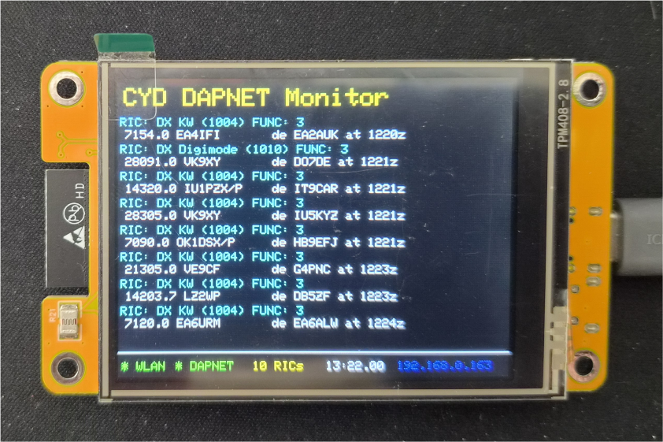
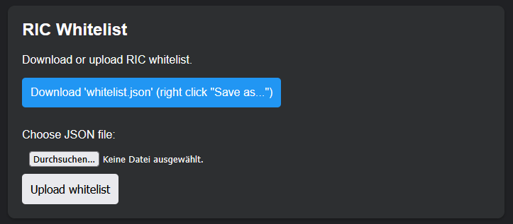

# CYD-DAPNET-Monitor v1.0

This is the "Cheap Yellow Display DAPNET Monitor", some kind of network (not radio) connected ham pager based on the popular CYD "ESP32-2432S028".
The code is completely vibecoded and created by Microsoft Copilot (that one that comes with Windows 11) in a few hours. I just prompted the Copilot and prettified the sourcecode.
**So be aware, the code is not tested systematically, the results and behavior were simply observed, and any issues identified were corrected in iterations.
The code could have some serious errors!**

## Features

  * WLAN connection to the network
  * Configuration via a built-in web page
  * Initial configuration via an access point (SSID: `CYD-DAPNET-Monitor`, password: `I@maHAM`) and the IP `192.168.4.1`
  * RIC whitelisting. A "whitelist.json" can be downloaded, modified and uploaded again to the internal LittleFS
  * Scrolling display of incoming and filtered messages
  * Status bar at the bottom with WLAN and DAPNET status, # of RIC whitelist entries, DAPNET local time (currently taken from RIC 224) and current IP address
  * Serial messages at device initialization and DAPNET receptions
  
## Build

The sources are built from an Arduino environment (I used Arduino IDE 1.8.19). Just put the whole folder `CNY-DAPNET-Monitor` to your Arduino sketchbook folder and open the project at the Arduino IDE.

### Prequisites

**The following helper must be installed to the Arduino environment:**

  * "Arduino ESP32 LittleFS filesystem uploader" from https://github.com/lorol/arduino-esp32littlefs-plugin

**The following board support package must be installed:**

  * "esp32" by Espressif Systems Version 3.0.7 (maybe compiles with later versions too).

**The following libraries must be installed:**

  * "TFT_eSPI" by Bodmer Version 2.5.43. Put the both files from `TFT_eSPI_User-Setup` into you library installation path of "TFT_eSPI".
  * "ESP Async WebServer" by ESP32Async Version 3.12.1
  * "AsyncTCP" by dvarrel Version 1.1.4
  * "ArduinoJson" by Benoit Blanchon Version 7.4.3
  * Some further includes are coming from the ESP32 core itself (e.g. WiFi, LittleFS, Preferences, ...) and don't need to be installed separately.

**Select the following board from the "ESP32 Arduino" list:**

  * "ESP32-2432S028R CYD" with its default parameters.
  * At the first upload select "Erase Flash Before Sketch Upload": "Enabled" (can be set back to "Disabled" after that).
  * Select the correct COM port for your CYD board.
  
### Upload the sketch and data

I suggest to do a first run without upload to check, if the code compiles so far. There could be some warnings from the ArduinoJson library, but they are not critical for the project.

Upload the data for the internal LittleFS with the installed tool "ESP32 LittleFS Data Upload". The tool compresses the data from the subfolder "\data" and creates a LittleFS binary which is then uploaded to the SPIFFS partition of the ESP32.

Then compile with upload. If all went fine, the status bar at the bottom should show "09 RICs".

### Configuration

Configure the device through the AP and the configuration webpage for the first time. If the device reboots then and connects to your local WLAN, the configuration page is accessible throug the IP displayed bottom left of the status bar.

If not happened before, enter your ham radio callsign and your "AuthKey" (provided by the DAPNET maintainers when applied for access to DAPNET).

To change the RIC whitelist, just download the current whitelist as a template by right clicking to the blue field an save the whitelist as "whitelist.json".
Edit the JSON-file according to you needs (max. 64 RICs). Use the file chooser to point to your edited "whitelist.json" and click "Upload whitelist". If the upload went fine a green message is shown and the RICs are loaded and activated immediately.

## Miscellaneous

This was a vibecoding experiment. I was very impressed by how quickly compilable and functional code was produced (just implementing the DAPNET client protocol alone would likely have taken me several days, not to mention handling the TFT display). Enhancements could be incorporated very quickly through several iterations.

Perhaps some of you might find this "DAPNET Monitor" useful. Enjoy...

## Licensing

Since the code was written entirely by an AI and my own contribution to it does not reach the threshold of originality required for copyright protection, I cannot claim copyright over the code.
Therefore, this code is in the public domain. Should a license be required for certain legal jurisdictions, the "Unlicense" shall apply (see "LICENSE").

**Should the AI ​​have replicated copyrighted code through memorization, I ask the copyright holder(s) to please let me know, so that I may, if necessary, expand the licensing for the code or remove it.**